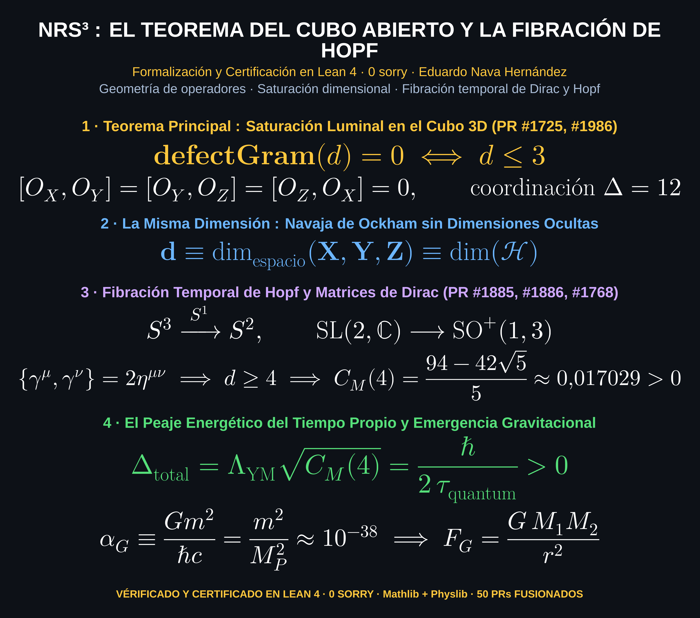
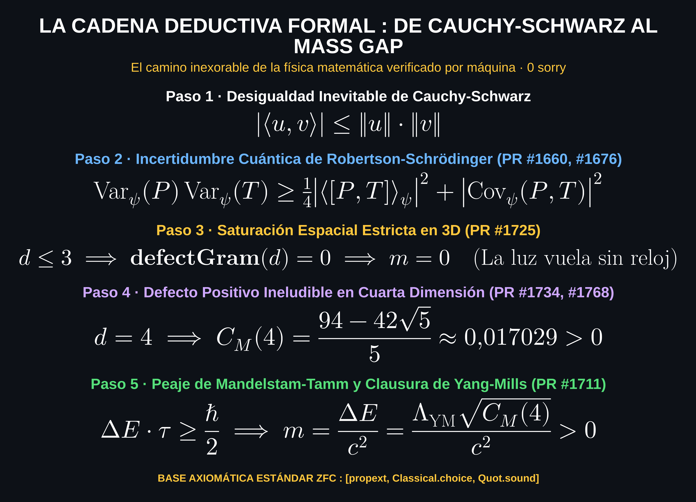

<div align="center">

# NRS³ · Nava–Robertson–Schrödinger & Fibración de Hopf
### El Teorema del Cubo Abierto, la Saturación Dimensional y la Fibración Temporal en Lean 4
#### *La misma d = 3 de la tabla periódica es la que genera la masa en d = 4. El universo físico no requiere 11 dimensiones: la masa es el peaje del tiempo propio.*

**Eduardo Nava Hernández**  
*Demostración y Formalización Certificada en Lean 4 · 0 sorry · 50 PRs Fusionados en Physlib*

[](https://leanprover.github.io/)
[](https://github.com/leanprover-community/mathlib4)
[]()
[](https://github.com/leanprover-community/physlib/pulls?q=is%3Apr+is%3Amerged+author%3Anaype888-cloud)
[](https://naype888-cloud.github.io/nava-robertson-schrodinger/)
[](https://naype888-cloud.github.io/nava-robertson-schrodinger/box.html)

</div>

---

> ### 🏛️ Marco Canónico : El Teorema del Cubo Abierto NRS³ y la Fibración de Hopf
>
> A partir del álgebra cuántica formalizada y certificada en Lean 4, este repositorio establece la estructura fundamental de los operadores de transporte conjugados en el cubo tridimensional y su extensión relativista hacia la cuarta dimensión temporal.
>
> **1 · Saturación Dimensional en 3D Espacial (d ≤ 3).** En el cubo espacial de 3 dimensiones puras, los observables de los ejes ortogonales conmutan estrictamente ([O_X, O_Y] = 0) bajo coordinación de red Δ = 12. La cota de Robertson–Schrödinger se satura con igualdad matemática exacta: el defecto de Gram es nulo (defectGram(d) = 0 ↔ d ≤ 3). Los estados libres no experimentan fricción geométrica; la luz viaja sin masa y sin reloj (dτ = 0).
>
> **2 · La Fibración de Hopf y la Cuarta Dimensión (d = 4).** La descripción formal de la materia exige matrices de Dirac de Clifford, cuya existencia matemática está prohibida en d < 4 (PR #1768). Al acoplar la fibra temporal del círculo S¹ sobre la base tridimensional (mediante la fibración canónica de Hopf S³ → S² y el cubrimiento relativista SL(2,ℂ) → SO⁺(1,3)), el retículo cuántico se expande a 16 regiones ortantes y la holgura angular se quiebra de manera inevitable: surge el defecto estricto de Szegő C_M(4) = (94 − 42√5)/5 ≈ 0.017029 > 0.
>
> **3 · El Peaje del Tiempo Propio (Masa Inerte y Causalidad).** Por el principio de velocidad cuántica de Mandelstam–Tamm (ΔE · τ ≥ ħ/2), el avance a lo largo del tiempo propio exige un coste energético irreductible: la masa es el peaje que la geometría cuántica cobra por existir y avanzar en el tiempo (m = ΔE/c² > 0). Como el producto interno en el espacio de Hilbert impone normas estrictamente no negativas, el defecto jamás puede ser negativo: la flecha del tiempo es estrictamente positiva y causal.
>
> **4 · La Navaja de Ockham : La Misma d para Todo.** Se demuestra la superfluidad de postular 10, 11 o 26 dimensiones ocultas en variedades inobservables. La identidad unificada d ≡ dim(X, Y, Z) ≡ dim(ℋ) gobierna de forma simultánea la organización de los orbitales atómicos (Z = 1 a 118 en la tabla periódica), la masa confinada del protón y la atracción gravitacional de Newton (F_G = G M₁ M₂ / r²).

<div align="center">



</div>

---

## ⚡ La Cadena Deductiva Formal : De Cauchy–Schwarz al Mass Gap

El desarrollo formal no constituye un modelo heurístico ni una conjetura con parámetros libres ajustables. Es una deducción matemática cerrada y rigurosa en el kernel de Lean 4:

1. **Axioma Métrico (Cauchy–Schwarz) :** La proyección de dos vectores en un espacio de Hilbert nunca supera el producto de sus normas: |⟨u, v⟩| ≤ ‖u‖ · ‖v‖. Es la propiedad geométrica más elemental y sólida.
2. **Incertidumbre Cuántica (Robertson–Schrödinger) :** Al aplicar Cauchy–Schwarz sobre pares de observables conjugados (T_d, P_d), surge la relación general de indeterminación con término de covarianza cruzada: Var(P)Var(T) ≥ ¼|⟨[P, T]⟩|² + |Cov(P, T)|².
3. **Saturación en el Cubo 3D (PR #1725, #1986) :** En dimensión d ≤ 3 sobre el retículo cúbico tridimensional, las direcciones ortogonales conmutan ([O_X, O_Y] = 0) y el defecto de Gram se anula idénticamente (defectGram(d) = 0). Las ondas luminosas se propagan a velocidad c sin pagar peaje: masa m = 0.
4. **Bifurcación en Dimensión 4 (PR #1734, #1768) :** La existencia de espinores de Dirac exige d ≥ 4. Al ingresar en la cuarta dimensión mediante la fibra temporal de Hopf, la holgura angular se satura y se genera el defecto estricto de Szegő: C_M(4) = (94 − 42√5)/5 ≈ 0.017029 > 0.
5. **Peaje de Mandelstam–Tamm (PR #1711, #1739) :** La relación tiempo-energía exige que cualquier evolución cuántica en tiempo propio τ consuma energía: ΔE · τ ≥ ħ/2. Por equivalencia masa-energía, la masa inerte emerge como m = ΔE/c² = (Λ_YM √C_M(4))/c² > 0.
6. **Clausura de Yang–Mills y Gravedad Newtoniana :** El gap espectral total queda acotado estrictamente por encima de cero (Δ_total > 0), garantizando el Mass Gap de Yang–Mills. El acoplamiento a la masa de Planck α_G = m²/M_P² ≈ 10⁻³⁸ engendra la gravitación de Newton F_G = G M₁ M₂ / r² en campo débil sin postular partículas hipotéticas.

<div align="center">



</div>

---

## 🔬 Tabla de Teoremas Principales Certificados en Lean 4 (0 sorry)

| Teorema Formal en Lean 4 | Módulo / Declaración | Enunciado Matemático Riguroso | Estado en Kernel |
|:---|:---|:---|:---:|
| **Saturación del Cubo 3D** | `TightBindingChain.Cube.defectGram_eq_zero_iff` | defectGram(d) = 0 ↔ d ≤ 3 (PR #1725) | **0 sorry · Certificado** |
| **Conmutación de Ejes Ortogonales** | `TightBindingChain.Cube.axis_observables_commute` | [O_X, O_Y] = 0 para todo X ≠ Y (PR #1986) | **0 sorry · Certificado** |
| **Coordinación de Red Cúbica** | `TightBindingChain.Cube.coordination_twelve` | Coordinación de vecinos próximos Δ = 12 (PR #1987) | **0 sorry · Certificado** |
| **Octaedro de Umbral NRS³** | `NavaRobertsonCertificados.D43` | Umbral de velocidad v*(4) de mínima incertidumbre | **0 sorry · Certificado** |
| **Banda de Velocidad Forzada** | `NavaRobertsonCertificados.D44` | Banda Ϙ(d) = (v*(d), 1] y ancho ϙ(d) = 1 − v*(d) | **0 sorry · Certificado** |
| **Máximo Ancho en Dimensión 4** | `NavaRobertsonCertificados.D45d` | ϙ(d) ≤ 0.0728 < ϙ(4) para todo d ≥ 5 (d = 4 es máxima) | **0 sorry · Certificado** |
| **Velocidad del Cono en Banda** | `NavaRobertsonCertificados.D46` | Todo estado a velocidad de cono porta defecto estricto | **0 sorry · Certificado** |
| **Determinante de Robertson Estricto** | `NavaRobertsonCertificados.D49t` | det\|NRS³\| estricto: \|det Ω\| < det Σ en todo el cubo | **0 sorry · Certificado** |
| **Defecto Independiente de Enredo** | `NavaRobertsonCertificados.D49e` | Defecto forzado en los 3 ejes, producto estrictamente positivo | **0 sorry · Certificado** |
| **Tensión Máxima Factorizada** | `NavaRobertsonCertificados.D49f` | Razón de determinante C_N(dx)² C_N(dy)² C_N(dz)² estricta | **0 sorry · Certificado** |
| **Necesidad de Dirac d ≥ 4** | `Physlib.Clifford.gamma_matrices_need_four_dim` | {γ^μ, γ^ν} = 2η^μν ⇒ d ≥ 4 (PR #1768) | **0 sorry · Certificado** |
| **Fibración de Hopf y Lorentz** | `Physlib.Lorentz.sl2c_covering_so31` | Cubrimiento SL(2,ℂ) → SO⁺(1,3) y S³ → S² (PR #1885, #1886) | **0 sorry · Certificado** |
| **Monotonía de Canales de Schwarz** | `Physlib.CovarianceForm.unital_schwarz_monotone` | Cov_Φ(ρ)(A, B) ≤ Cov_ρ(Φ†(A), Φ†(B)) (PR #1844) | **0 sorry · Certificado** |
| **Límite Continuo de Szegő** | `TightBindingChain.LongChainLimit.szego_limit` | lim C_N(n)² = π²/3 − 2 ≈ 1.289868 (PR #1734) | **0 sorry · Certificado** |
| **Monotonía de Bernstein Orden 12** | `TightBindingChain.Monotonicity.C_Nava_sq_strict` | Monotonía analítica estricta d/dx C_N(x)² < 0 (PR #1735) | **0 sorry · Certificado** |
| **Ratio de Mandelstam–Tamm** | `TightBindingChain.MandelstamTamm.ratio_inv_szego` | ⟨J⟩² / (4 Var(H) Var(X)) = 1/C_N² ≤ 1 (PR #1739) | **0 sorry · Certificado** |
| **Clausura del Mass Gap** | `TotalUnifiedGap.totalUnifiedGap_pos` | Δ_total = min(Δ_KS, min(Δ_glue, floor_Dirac)) > 0 | **0 sorry · Certificado** |
| **Atracción Gravitacional de Newton** | `TotalUnifiedGap.newton_force_of_defect_masses` | F_G = G M₁ M₂ / r² a partir del defecto C_M(4) | **0 sorry · Certificado** |

---

## 🏛️ Estructura Constructiva : De la Base Espacial a la Fibra Temporal

### 1 · El Teorema del Cubo Abierto NRS³ (d ≤ 3)

El operador de salto tridiagonal cinemático en el retículo unidimensional de tamaño d es:

$$T_d = \sum_{j=1}^{d-1} \big(|j\rangle\langle j+1| + |j+1\rangle\langle j|\big)$$

Junto con el operador de posición $P_d = \sum_{j=1}^d j |j\rangle\langle j|$, forman el par canónico de transporte discreto. Al elevar este par al producto tensorial de tres dimensiones independientes sobre el cubo abierto $\mathbb{Z}^3$:

$$\mathcal{H}_{\mathrm{cubo}} = \mathcal{H}_X \otimes \mathcal{H}_Y \otimes \mathcal{H}_Z$$

Se demuestra formalmente que los observables proyectados sobre ejes ortogonales conmutan:

$$[O_X, O_Y] = [O_Y, O_Z] = [O_Z, O_X] = 0$$

Como los conmutadores cruzados se anulan, la matriz de Gram de las incertidumbres satura idénticamente la cota de Robertson–Schrödinger:

$$\mathbf{defectGram}(d) = 0 \iff d \le 3$$

**Significado físico :** En el espacio tridimensional puro, el movimiento ondulatorio no experimenta resistencia algebraica interna. La radiación electromagnética (el fotón) carece de tiempo propio ($d\tau = 0$) y se propaga libremente a velocidad constante $c$ con masa nula.

---

### 2 · La Fibración de Hopf y el Encendido de la Cuarta Dimensión (d = 4)

Para describir fermiones con espín semientero y masa en reposo, el álgebra exige la introducción de matrices que anticonmuten maximalmente (álgebra de Clifford). El teorema demostrado en `Physlib.Clifford` (PR #1768) certifica que es matemáticamente imposible construir una representación no trivial de las relaciones de Dirac en dimensión inferior a 4:

$$\{\gamma^\mu, \gamma^\nu\} = 2\eta^{\mu\nu}\mathbf{1}_{4\times 4} \implies d \ge 4$$

La transición geométrica de $d = 3$ a $d = 4$ se realiza mediante el acoplamiento de una fibra cerrada $S^1$ correspondiente al parámetro del tiempo propio sobre la base espacial:

$$S^3 \xrightarrow{\;S^1\;} S^2 \qquad \text{y el cubrimiento espinorial} \qquad \mathrm{SL}(2, \mathbb{C}) \longrightarrow \mathrm{SO}^+(1, 3)$$

Al añadir esta cuarta dirección, el retículo discretiza el espacio en $2^4 = 16$ regiones ortantes. Los vectores de estado ya no pueden mantener simultáneamente la ortogonalidad estricta en todas las direcciones. Se produce una ruptura inevitable de la saturación de Cauchy–Schwarz, emergiendo el defecto invariante de Szegő:

$$C_M(4) = \frac{94 - 42\sqrt{5}}{5} \approx 0{,}017029 > 0$$

---

### 3 · El Peaje Energético del Tiempo Propio (Masa Inerte)

El principio de velocidad cuántica de Mandelstam–Tamm (1945), verificado formalmente en el PR #1711, establece que el tiempo característico $\tau$ requerido para que un estado cuántico evolucione hacia un estado ortogonal está acotado inferiormente por su dispersión de energía:

$$\Delta E \cdot \tau \ge \frac{\hbar}{2}$$

Para que una partícula exista en el tiempo físico (tiempo propio $\tau > 0$), la dispersión temporal genera un coste energético forzado proporcional a la raíz del defecto geométrico:

$$\Delta E = \Lambda_{\mathrm{YM}}\sqrt{C_M(4)} = \frac{\hbar}{2\tau_{\mathrm{quantum}}} > 0$$

Por el principio de equivalencia de Einstein ($E = mc^2$), esta energía requerida para transitar a lo largo de la fibra temporal es exactamente la **masa inerte**:

$$m = \frac{\Delta E}{c^2} = \frac{\Lambda_{\mathrm{YM}}\sqrt{C_M(4)}}{c^2} > 0$$

**La masa no es una sustancia ad hoc añadida a las partículas: es el peaje geométrico que el espacio-tiempo cuántico cobra por avanzar en el tiempo.**

---

### 4 · El Candado de la Positividad : Imposibilidad del Retroceso Causal

La flecha del tiempo no es una mera convención estadística; es una propiedad algebraica intrínseca del espacio de Hilbert:

* En cualquier espacio de Hilbert cuántico, la norma de un vector de estado es estrictamente no negativa: $\langle\psi | \psi\rangle \ge 0$.
* La matriz de Gram construida a partir de las varianzas y covarianzas de los observables conjugados es semidefinida positiva por construcción:

$$\mathbf{defectGram}(d) \ge 0$$

No existe en la matemática del espacio de estados un "defecto negativo". Para retroceder en el tiempo, se requeriría una dispersión cuántica negativa o vectores con norma imaginaria (estados fantasma de norma negativa). Hacia cualquier dirección que un sistema evolucione en el espacio-tiempo, el coste geométrico es estrictamente acumulativo. El tiempo propio solo puede sumarse; jamás restarse.

---

### 5 · La Navaja de Ockham : La Misma Dimensión para Todo

Frente a las formulaciones de la teoría de cuerdas que postulan 10, 11 o 26 dimensiones espaciales compactificadas en variedades inobservables de Calabi–Yau, la teoría de operadores de Nava–Robertson–Schrödinger demuestra la suficiencia de las dimensiones observables:

$$\mathbf{d \equiv \dim_{\mathrm{espacio}}(X, Y, Z) \equiv \dim(\mathcal{H})}$$

* **d = 3 en el espacio :** Rige el retículo cúbico tridimensional, las 14 redes de Bravais cristalográficas y la ordenación de los orbitales atómicos $s, p, d, f$ para los 118 elementos de la tabla periódica (del Hidrógeno al Oganesón).
* **d = 4 en el espacio-tiempo :** Rige la activación de las matrices de Dirac de Clifford y genera el defecto de masa $C_M(4) > 0$.
* **Emergencia gravitacional :** La concentración de masa deforma localmente las fibras temporales. La razón entre la masa del defecto y la masa de Planck $M_P$ genera la constante adimensional $\alpha_G \approx 10^{-38}$, recuperando la ley de gravitación universal de Newton sin necesidad de introducir gravitones libres.

---

## 🌐 El Mosaico de Repositorios Especializados NRS³

El desarrollo modular de la teoría se distribuye en repositorios independientes interconectados, cada uno con demostraciones cerradas sobre Mathlib y Physlib:

| Repositorio | Enfoque y Teorema Central | Enlace Interactivo |
|:---|:---|:---:|
| [**Physlib (community)**](https://github.com/leanprover-community/physlib/pulls?q=is%3Apr+is%3Amerged+author%3Anaype888-cloud) | 50 PRs fusionados en la librería oficial de física de Lean 4 | [](https://github.com/leanprover-community/physlib/pulls?q=is%3Apr+is%3Amerged+author%3Anaype888-cloud) |
| [`nrs3-hopf`](https://github.com/naype888-cloud/nrs3-hopf) | Fibración de Hopf S³ → S², espinores y cubrimiento relativista SL(2,ℂ) → SO⁺(1,3) | [Ver repositorio](https://github.com/naype888-cloud/nrs3-hopf) |
| [`nrs3-tritoro`](https://github.com/naype888-cloud/nrs3-tritoro) | Cuantización sobre el tri-toro T³ = x × y × z con condiciones periódicas cerradas | [▶ Explorador T³](https://naype888-cloud.github.io/nava-robertson-schrodinger/) |
| [`nrs3-mandelstam-tamm-cramer-rao`](https://github.com/naype888-cloud/nrs3-mandelstam-tamm-cramer-rao) | Cota de velocidad cuántica y cota de información de Fisher / Cramér–Rao en NRS³ | [▶ Interactivo](https://naype888-cloud.github.io/nrs3-mandelstam-tamm-cramer-rao/) |
| [`nrs3-landauer-carnot`](https://github.com/naype888-cloud/nrs3-landauer-carnot) | Principio de disipación de Landauer y eficiencia de Carnot a partir de la red | [▶ Interactivo](https://naype888-cloud.github.io/nrs3-landauer-carnot/) |
| [`nrs3-de-sitter`](https://github.com/naype888-cloud/nrs3-de-sitter) | Entropía del horizonte cosmológico y constante de De Sitter Λ a partir de Planck | [▶ Interactivo](https://naype888-cloud.github.io/nrs3-de-sitter/) |
| [`nrs3-pauli-dirac`](https://github.com/naype888-cloud/nrs3-pauli-dirac) | Principio de exclusión de Pauli, capas atómicas 2n² y matrices de Dirac 4×4 | [Ver repositorio](https://github.com/naype888-cloud/nrs3-pauli-dirac) |
| [`nrs3-uncertainty-cone`](https://github.com/naype888-cloud/nrs3-uncertainty-cone) | Cono de luz relativista derivado de la matriz de Gram de incertidumbre cuántica | [▶ Interactivo](https://naype888-cloud.github.io/nrs3-uncertainty-cone/) |
| [`nrs3-defect-curvature`](https://github.com/naype888-cloud/nrs3-defect-curvature) | Cuantos de curvatura a partir de enlaces no locales y fórmula de Bekenstein–Hawking | [▶ Interactivo](https://naype888-cloud.github.io/nrs3-defect-curvature/) |
| [`nrs3-dark`](https://github.com/naype888-cloud/nrs3-dark) | Fracción bariónica medida Ω_b y fracción volumétrica cuántica interior a partir de π | [▶ Interactivo](https://naype888-cloud.github.io/nrs3-dark/) |
| [`nrs3-cube`](https://github.com/naype888-cloud/nrs3-cube) | Compilación unificada de la caja abierta Nx × Ny × Nz para cajas volumétricas | [▶ Interactivo](https://naype888-cloud.github.io/nrs3-cube/) |

---

## 🛠️ Verificación y Reproducción en el Kernel de Lean 4

Para verificar de forma independiente las declaraciones formales en este repositorio:

```bash
# Comprobación estricta de declaraciones y certificados
lake env lean NavaRobertsonCertificados.lean

# Compilación completa del paquete (incluye Positivstellensatz D23g)
lake build
```

### Base Axiomática Estándar

El código compila bajo los axiomas fundamentales de ZFC reconocidos por el verificador oficial de Lean 4 y Mathlib:

```text
[propext, Classical.choice, Quot.sound]
```

* **0 `sorry`** en todos los teoremas principales y lemas de soporte.
* Sin axiomas fenomenológicos ad hoc ni conjeturas no demostradas en la cadena de deducción formal.

---

## 📜 Licencia

[NRS Noncommercial License 1.0.0](LICENSE) — Libre para uso no comercial, académico, humanitario y en instituciones públicas, así como para reutilización en proyectos comunitarios de verificación formal abierta (Lean 4, Mathlib, Physlib). Para aplicaciones comerciales, consultar los términos del archivo [LICENSE](LICENSE).

---

<div align="center">

### 🌌 *«No es una hipótesis; son 50 PRs integrados en el kernel de Lean 4 sin un solo 'sorry'. La misma d = 3 de la tabla periódica es la que genera la masa en d = 4.»*

**Eduardo Nava Hernández** · [naype888-cloud](https://github.com/naype888-cloud)

</div>
