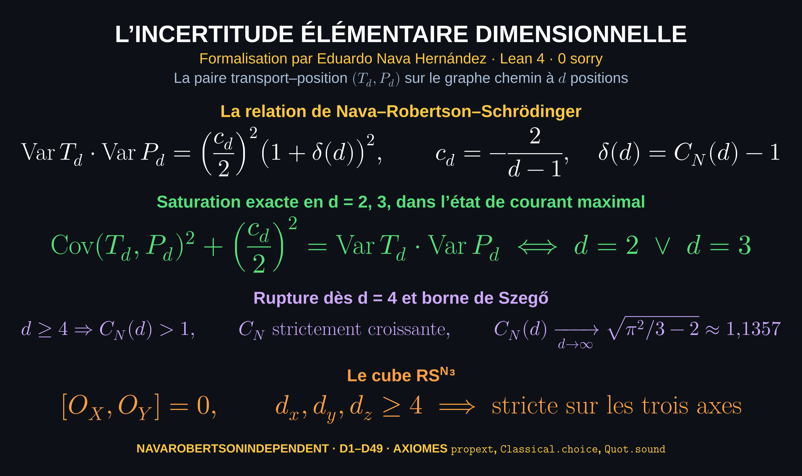
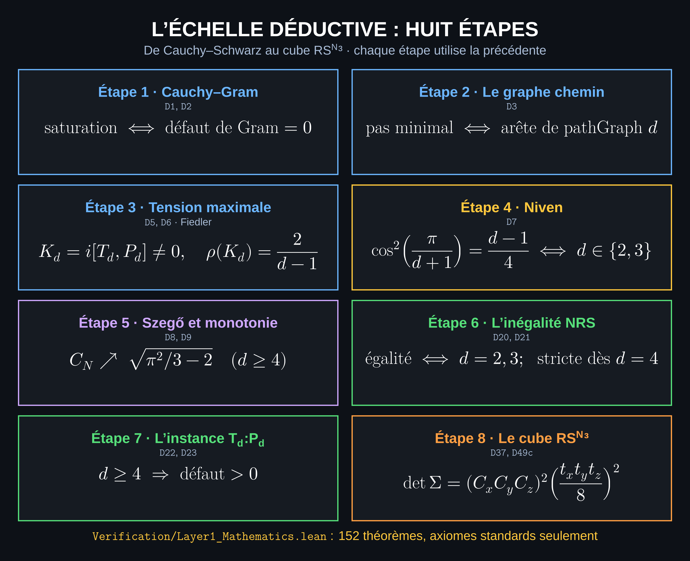
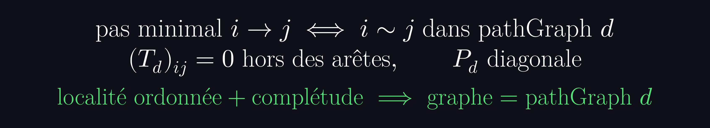
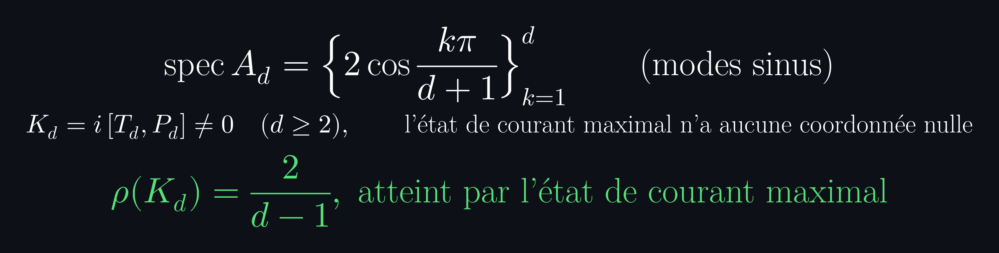
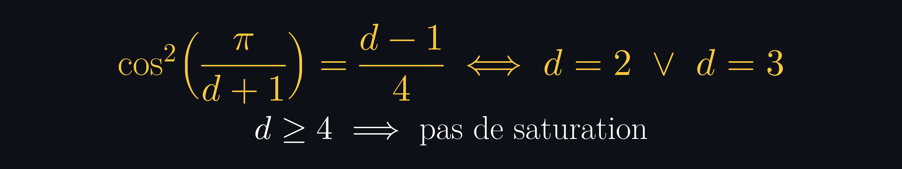
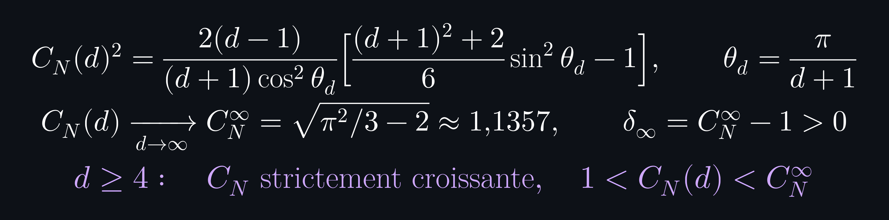
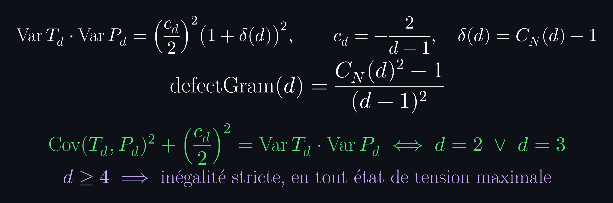
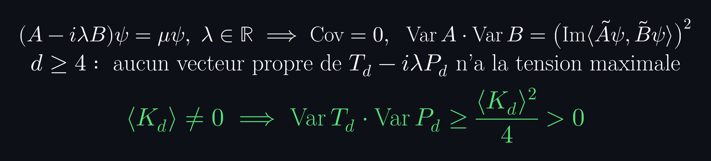
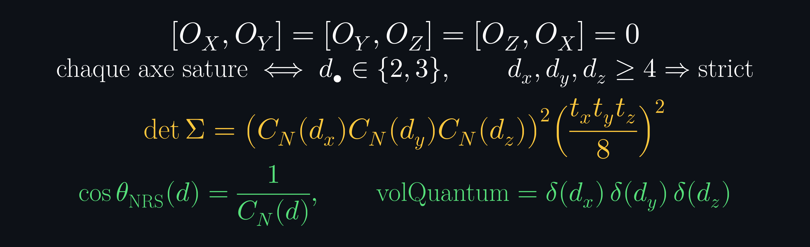

<div align="center">

# RS<sup>N</sup> et RS<sup>N</sup>³ · L’incertitude élémentaire dimensionnelle
### Pour la paire transport–position (T_d, P_d) sur le graphe chemin à d positions, Robertson–Schrödinger est une égalité exactement en d = 2, 3 et stricte dès d = 4, avec la constante C_N(d) qui croît vers √(π²/3 − 2) — sur la chaîne et sur le cube

**Eduardo Nava Hernández**  
*Vérification formelle en Lean 4 · 0 sorry · Mathlib · Physlib*

[](https://leanprover.github.io/)
[](https://github.com/leanprover-community/mathlib4)
[](Verification/Layer1_Mathematics.lean)
[](https://github.com/leanprover-community/physlib/pulls?q=is%3Apr+is%3Amerged+author%3Anaype888-cloud)
[](https://naype888-cloud.github.io/nava-robertson-schrodinger/)
[](https://naype888-cloud.github.io/nava-robertson-schrodinger/box.html)

</div>

---

> ### 🏛️ Le théorème : la relation de Nava–Robertson–Schrödinger
>
> Sur le graphe chemin à d positions, le transport T_d ne relie que des positions voisines et la position P_d est diagonale. Dans l’état de courant maximal, le produit des variances vaut exactement (c_d/2)²(1 + δ(d))², avec c_d = −2/(d − 1) et δ(d) = C_N(d) − 1. Ce qui distingue le théorème de Robertson–Schrödinger général : l’écart δ(d) est calculé en forme fermée, il est nul exactement pour d = 2, 3 et strictement positif dès d = 4.
>
> <div align="center">
> 
> </div>
>
> **1 · Saturation exacte en d = 2, 3.** Cov(T_d, P_d)² + (c_d/2)² = Var T_d · Var P_d si et seulement si d = 2 ou d = 3 : c’est l’équation de Niven cos²(π/(d+1)) = (d − 1)/4.
>
> **2 · Rupture dès d = 4.** C_N(d) > 1, et l’inégalité est stricte en tout état de tension maximale.
>
> **3 · Monotonie et borne de Szegő.** C_N est strictement croissante dès d = 4 et tend vers C_N^∞ = √(π²/3 − 2) ≈ 1,1357 sans l’atteindre.
>
> **4 · Le cube RS^N³.** Les observables d’axes différents commutent ; chaque axe sature exactement en 2 ou 3 positions, et la relation est stricte sur les trois axes dès 4 × 4 × 4.

---

## ⚡ Résumé formel

Les 68 modules de [NavaRobertsonIndependent/Mathematics/](NavaRobertsonIndependent/Mathematics) (`D0` à `D57`) compilent sur Mathlib et Physlib ; [`Verification/Layer1_Mathematics.lean`](Verification/Layer1_Mathematics.lean) vérifie la clôture des imports et imprime les axiomes de 152 théorèmes principaux : seulement `propext`, `Classical.choice`, `Quot.sound`. Les certificats numériques (H₄, bandes de vitesse) sont dans la cible séparée [NavaRobertsonCertificados/](NavaRobertsonCertificados), vérifiée par [`Verification/Certificados.lean`](Verification/Certificados.lean).

La chaîne est celle des fichiers `D1` → `D23` : Cauchy–Gram, Robertson, graphe chemin, tension maximale, Fiedler, Niven, Szegő, monotonie, puis l’inégalité NRS et son instance `T_d : P_d` ; `D37` et `D49c` la portent sur le cube.

---

## 📐 Chaîne déductive en huit étapes

<div align="center">

</div>

### Étape 1 : Cauchy–Gram et Robertson–Schrödinger

> **Proposition 1.1.** L’inégalité de Cauchy–Schwarz sur les vecteurs centrés Ãψ, B̃ψ donne Robertson–Schrödinger ; l’égalité a lieu si et seulement si le défaut de Gram ‖Ãψ‖²‖B̃ψ‖² − |⟨Ãψ, B̃ψ⟩|² est nul.

<div align="center"></div>

*Module formel :* [`D1_CauchyGramInequality.lean`](NavaRobertsonIndependent/Mathematics/D1_CauchyGramInequality.lean) (`gramDefectC_nonneg`, `robertsonSchrodinger_from_gram`, `robertsonSchrodinger_saturated_iff_gram_zero`).  
*Module formel :* [`D2_Robertson.lean`](NavaRobertsonIndependent/Mathematics/D2_Robertson.lean) (`schrodingerFloor_le_mul`).

---

### Étape 2 : Le graphe chemin

> **Proposition 2.1.** Les pas minimaux entre positions sont exactement les arêtes de `pathGraph d` ; le transport T_d n’agit que sur ces arêtes et la position P_d est diagonale. La localité ordonnée et la complétude forcent le graphe à être le chemin.

<div align="center"></div>

*Module formel :* [`D3_PathGraph.lean`](NavaRobertsonIndependent/Mathematics/D3_PathGraph.lean) (`minStep_iff_adj`, `Td_eq_zero_of_not_adj`, `Pd_eq_zero_offdiag`, `graph_eq_pathGraph`).

---

### Étape 3 : La tension maximale et Fiedler

> **Proposition 3.1.** Les modes sinus donnent tout le spectre 2 cos(kπ/(d+1)) de la matrice d’adjacence A_d. La tension K_d = i[T_d, P_d] est non nulle pour d ≥ 2 ; son rayon spectral 2/(d − 1) est atteint par l’état de courant maximal, qui n’a aucune coordonnée nulle.

<div align="center"></div>

*Module formel :* [`D5_MaximalTension.lean`](NavaRobertsonIndependent/Mathematics/D5_MaximalTension.lean) (`extremalState_attains_specRadius`, `fiedlerVec_apply_ne_zero`, `KdOp_ne_zero`).  
*Module formel :* [`D6_Fiedler.lean`](NavaRobertsonIndependent/Mathematics/D6_Fiedler.lean) (`eigenvalueAd_exhausts_spectrum`, `KdOp_fiedlerVec`, `specRadius_KdOp_eq_step`).

---

### Étape 4 : Niven

> **Proposition 4.1.** cos²(π/(d+1)) = (d − 1)/4 si et seulement si d = 2 ou d = 3 ; il n’y a pas de saturation pour d ≥ 4.

<div align="center"></div>

*Module formel :* [`D7_Niven.lean`](NavaRobertsonIndependent/Mathematics/D7_Niven.lean) (`saturation_iff`, `not_saturated_of_four_le`).

---

### Étape 5 : Szegő et la monotonie

> **Proposition 5.1.** C_N(d)² a une forme fermée en θ_d = π/(d+1) ; C_N(d) tend vers C_N^∞ = √(π²/3 − 2), avec δ_∞ = C_N^∞ − 1 > 0. Pour d ≥ 4, C_N est strictement croissante et 1 < C_N(d) < C_N^∞.

<div align="center"></div>

*Module formel :* [`D8_Szego.lean`](NavaRobertsonIndependent/Mathematics/D8_Szego.lean) (`tendsto_CoherenceConstant`, `deltaInf_pos`, `geometricGap_pos_of_four_le`).  
*Module formel :* [`D9_Monotonicity.lean`](NavaRobertsonIndependent/Mathematics/D9_Monotonicity.lean) (`CoherenceConstant_strictMonoOn_ge_four`, `CoherenceConstant_lt_CoherenceConstantInf`, `geometricGap_lt_deltaInf`).

---

### Étape 6 : L’inégalité NRS

> **Théorème 6.1.** Dans l’état de courant maximal, Var T_d · Var P_d = (c_d/2)²(1 + δ(d))², et le défaut de Gram vaut (C_N(d)² − 1)/(d − 1)². L’égalité Cov² + (c_d/2)² = Var T_d · Var P_d a lieu si et seulement si d = 2 ou d = 3 ; pour d ≥ 4 l’inégalité est stricte, en tout état de tension maximale.

<div align="center"></div>

*Module formel :* [`D20_GramStepCoherenceConstant.lean`](NavaRobertsonIndependent/Mathematics/D20_GramStepCoherenceConstant.lean) (`gramStep_product`, `gramStep_gram`).  
*Module formel :* [`D21_ElementalNRSInequality.lean`](NavaRobertsonIndependent/Mathematics/D21_ElementalNRSInequality.lean) (`variance_mul_variance`, `saturation_iff`, `strict_inequality`, `strict_inequality_of_maxTension`).

---

### Étape 7 : L’instance T_d : P_d et les vecteurs propres

> **Proposition 7.1.** L’instance position–transport sur T_d : P_d a un défaut strictement positif dès d = 4. Un vecteur propre de A − iλB (λ réel) sature Robertson–Schrödinger, mais pour d ≥ 4 aucun vecteur propre de T_d − iλP_d n’a la tension maximale ; dès que ⟨K_d⟩ ≠ 0, Var T_d · Var P_d ≥ ⟨K_d⟩²/4 > 0.

<div align="center"></div>

*Module formel :* [`D22_TransportPositionInstanceTdPd.lean`](NavaRobertsonIndependent/Mathematics/D22_TransportPositionInstanceTdPd.lean) (`positionTransportTdPd`, `defect_pos_TdPd`).  
*Module formel :* [`D23_EigenvectorSaturation.lean`](NavaRobertsonIndependent/Mathematics/D23_EigenvectorSaturation.lean) (`saturation_of_eigenvector`, `eigenvector_not_maxTension`, `variance_mul_variance_pos`).

---

### Étape 8 : Le cube RS^N³

> **Théorème 8.1.** Sur le cube Hd_x ⊗ Hd_y ⊗ Hd_z, les observables d’axes différents commutent. Dans l’état de courant maximal du cube, chaque axe sature si et seulement s’il a 2 ou 3 positions, et la relation est stricte sur les trois axes dès d_x, d_y, d_z ≥ 4. Le déterminant de covariance des six observables vaut (C_N(d_x) C_N(d_y) C_N(d_z))² (t_x t_y t_z / 8)², où t est la tension de chaque axe ; l’angle NRS vérifie cos θ_NRS(d) = 1/C_N(d), et le quantum volumétrique est δ(d_x) δ(d_y) δ(d_z).

<div align="center"></div>

*Module formel :* [`D37_PathGraph3D.lean`](NavaRobertsonIndependent/Mathematics/D37_PathGraph3D.lean) (`commutator_axes_xy`, `saturation_cube`, `strict_cube`).  
*Module formel :* [`D49c_RobertsonDeterminantProduct.lean`](NavaRobertsonIndependent/Mathematics/D49c_RobertsonDeterminantProduct.lean) (`det_covMatrix_maxCurrentCubeState`, `robertson_det_maxCurrentCubeState_strict`).  
*Module formel :* [`D37b_NRSAngle.lean`](NavaRobertsonIndependent/Mathematics/D37b_NRSAngle.lean) (`cos_angleNRS`, `angleNRS_eq_zero_iff`).  
*Module formel :* [`D37e_VolumetricQuantum.lean`](NavaRobertsonIndependent/Mathematics/D37e_VolumetricQuantum.lean) (`volQuantum`).

---

## 🧭 Au-delà de la chaîne

Les autres modules du dépôt, chacun sous le titre de son propre fichier :

| Module | Titre |
|:---|:---|
| [D10](NavaRobertsonIndependent/Mathematics/D10_Certificate.lean) | Certificat conjoint : Fiedler, Niven, Szegő sur H_d |
| [D23f](NavaRobertsonIndependent/Mathematics/D23f_MinUncertaintyTensionFour.lean) | Un état d’incertitude minimale de H₄ de tension 1/φ |
| [D24](NavaRobertsonIndependent/Mathematics/D24_GapFourAsymptote.lean) | L’écart entre `d = 4` et la limite de Szegő |
| [D25](NavaRobertsonIndependent/Mathematics/D25_DimensionalQuantum.lean) | Le quantum dimensionnel |
| [D28](NavaRobertsonIndependent/Mathematics/D28_BakryEmeryCurvature.lean), [D28b](NavaRobertsonIndependent/Mathematics/D28b_OllivierCurvature.lean) | Courbures de Bakry–Émery (`CD(0, 2)`, optimale) et d’Ollivier–Ricci du chemin |
| [D37c](NavaRobertsonIndependent/Mathematics/D37c_CubeSpectrum.lean) | Le spectre du cube, axe par axe |
| [D37f](NavaRobertsonIndependent/Mathematics/D37f_LightCone.lean), [D37g](NavaRobertsonIndependent/Mathematics/D37g_LiebRobinson.lean) | Le cône de lumière du transport ; borne de Lieb–Robinson |
| [D40](NavaRobertsonIndependent/Mathematics/D40_SpeedLimitUncertainty.lean), [D41](NavaRobertsonIndependent/Mathematics/D41_MandelstamTammCramerRao.lean) | La vitesse limite exclut l’incertitude minimale ; Mandelstam–Tamm et Cramér–Rao sur `T_d : P_d` |
| [D49](NavaRobertsonIndependent/Mathematics/D49_RobertsonDeterminant.lean), [D49g](NavaRobertsonIndependent/Mathematics/D49g_RobertsonDeterminantEquality.lean) | Robertson 1934 pour plusieurs observables, et son cas d’égalité |
| [D16c](NavaRobertsonIndependent/Mathematics/D16c_DefectExcitation.lean) … [D16i](NavaRobertsonIndependent/Mathematics/D16i_CutHorizon.lean) | Le défaut transporté : excitation, cycles des liens non locaux, entropie et horizon d’une coupe |
| [D26a](NavaRobertsonIndependent/Mathematics/D26a_OmegaFromPi.lean) | `g_s e^{−1/C_N^∞}` à partir de `π`, avec un encadrement rationnel |

Le pont avec Physlib est [`PhyslibBridge.lean`](NavaRobertsonIndependent/Mathematics/PhyslibBridge.lean) (`robertson_schrodinger_eq_D21`).

---

## 🔬 Contributions Physlib fusionnées

| PR Physlib | Fichier amont (`PhyslibAlpha/…`) | Énoncé formel principal | Module local |
|:---:|:---|:---|:---:|
| **#2096** | `TightBindingChain/Open/Basic` | La chaîne ouverte est le saut de `pathGraph` | `D3` |
| **#1716** | `TightBindingChain/MaxCurrentState` | L’état de courant maximal | `D5` |
| **#1718** | `TightBindingChain/Saturation` | Égalité de Robertson–Schrödinger ⟺ N = 2, 3 | `D21` |
| **#1723** | `TightBindingChain/ElementalUncertainty` | Produit des variances et défaut | `D21` |
| **#1732** | `TightBindingChain/MaxCurrentVariances` | Forme fermée de C_N² | `D20` |
| **#1734** | `TightBindingChain/LongChainLimit` | C_N → √(π²/3 − 2) | `D8` |
| **#1735** | `TightBindingChain/LongChainMonotonicity` | Monotonie stricte de C_N dès 4 positions | `D9` |
| **#1699**, **#1717** | `FiniteTarget/Product`, `ProductState` | Opérateurs sur une coordonnée, états produits | `D37` |
| **#1725** | `TightBindingChain/Cube` | Le cube ouvert, axes qui commutent | `D37` |
| **#1742** | `TightBindingChain/Cube` (E–F) | Déterminant de Robertson du cube | `D49c` |
| **#1756** | `TightBindingChain/VolumetricQuantum` | Angle NRS et quantum volumétrique | `D37b`, `D37e` |
| **#1986** | `TightBindingChain/Cube/AxisCommutation` | Deux observables commutent ⟺ axes différents | `D37` |

La liste complète, chemin par chemin, est dans [lean4-commits](https://github.com/naype888-cloud/lean4-commits).

---

## 🏛️ La mosaïque

| Dépôt | Objet |
|:---|:---|
| [lean4-commits](https://github.com/naype888-cloud/lean4-commits) | Tout le travail en Lean 4 : les huit chemins fusionnés dans Physlib |
| [nrs3-tightbinding](https://github.com/naype888-cloud/nrs3-tightbinding) | La chaîne de Physlib, le cube ouvert et la table périodique |
| [nrs3-cristales](https://github.com/naype888-cloud/nrs3-cristales) | Symétrie, spectre et le pas d’axe : fcc et bcc |
| [nrs3-hidrogeno](https://github.com/naype888-cloud/nrs3-hidrogeno) | L’atome d’hydrogène sur les sites entiers du cube |
| [nrs3-uncertainty-cone](https://github.com/naype888-cloud/nrs3-uncertainty-cone) | La matrice de Gram d’une paire conjuguée est un quadrivecteur de Minkowski |
| [nrs3-mandelstam-tamm-cramer-rao](https://github.com/naype888-cloud/nrs3-mandelstam-tamm-cramer-rao) | Borne temps–énergie et Cramér–Rao |
| [nrs3-pauli-dirac](https://github.com/naype888-cloud/nrs3-pauli-dirac) | Exclusion, matrices de spin et matrices gamma |
| [nrs3-hopf](https://github.com/naype888-cloud/nrs3-hopf) | La boîte à quatre axes, une fibre fermée sur le cube ouvert |
| [nrs3-landauer-carnot](https://github.com/naype888-cloud/nrs3-landauer-carnot) | Landauer et Carnot |
| [nrs3-poincare](https://github.com/naype888-cloud/nrs3-poincare) | La loi de Planck force des niveaux discrets |
| [nrs3-defect-curvature](https://github.com/naype888-cloud/nrs3-defect-curvature) | Chaque lien non local ferme un cycle avec un quantum |
| [nrs3-de-sitter](https://github.com/naype888-cloud/nrs3-de-sitter) | Entropie d’horizon et constante cosmologique |
| [nrs3-dark](https://github.com/naype888-cloud/nrs3-dark) | `1 − Ω_b`, l’intérieur du quantum volumétrique |
| [nrs3-penrose](https://github.com/naype888-cloud/nrs3-penrose), [nrs3-rovelli-lqg](https://github.com/naype888-cloud/nrs3-rovelli-lqg) | Propositions |

---

## ⏱️ Chronologie historique (1911–1945)

| Année | Événement | Ici |
|:---:|:---|:---:|
| **1915–20** | Szegő : théorèmes limites des matrices de Toeplitz | `D8` |
| **1927** | Heisenberg : relations d’incertitude | — |
| **1929–30** | Robertson et Schrödinger : l’inégalité avec covariance | `D1`, `D2` |
| **1934** | Robertson : le déterminant pour plusieurs observables | `D49`, `D49c` |
| **1945–46** | Mandelstam et Tamm : la borne temps–énergie | `D41` |

**Antécédents et outils hors de la fenêtre.** Fiedler (1973), Niven (1956), Lean 4, Mathlib et Physlib.

---

## 🛠️ Compilation et certification

```bash
lake build
lake env lean Verification/Layer1_Mathematics.lean
lake build NavaRobertsonCertificados && lake env lean Verification/Certificados.lean
```

```text
[propext, Classical.choice, Quot.sound]
```

* **0 `sorry`** ; 152 théorèmes principaux imprimés par la vérification, aucun axiome propre.

---

## 📜 Licence

[NRS Noncommercial License 1.0.0](LICENSE) — libre pour tout usage non commercial, académique et humanitaire, et pour l’intégration dans des bibliothèques ouvertes de vérification formelle (Mathlib, Physlib, Lean 4).

---

<div align="center">

### 📐 *« Robertson–Schrödinger sur T_d : P_d est une égalité exactement en d = 2, 3 ; dès d = 4 l’excès δ(d) = C_N(d) − 1 est strictement positif, croît, et reste sous la borne de Szegő. »*

**Eduardo Nava Hernández** · [naype888-cloud](https://github.com/naype888-cloud)

</div>
