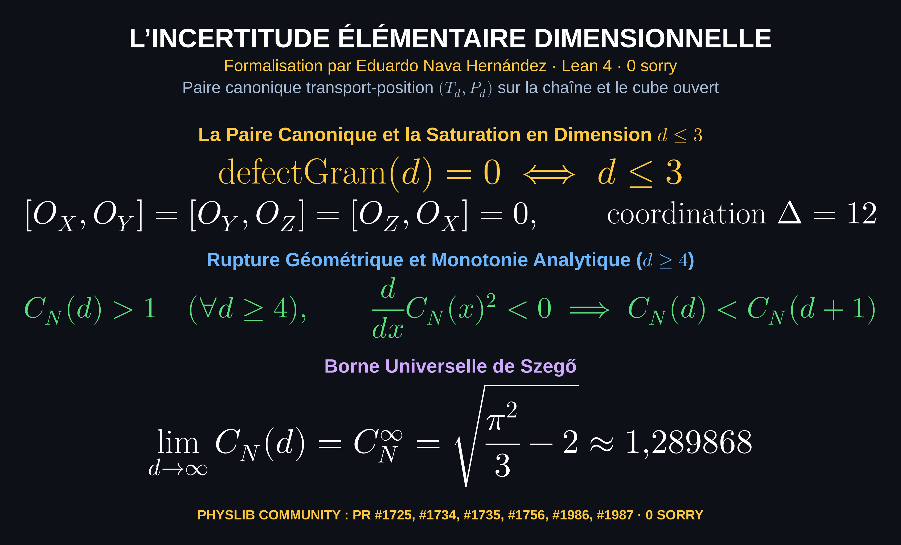

<div align="center">

# Incertitude élémentaire dimensionnelle : le cube NRS³ et la monotonie de C_N
### Structure géométrique du cube discret, séparation tensorielle des axes et borne asymptotique de Szegő

**Eduardo Nava Hernández**  
*Vérification formelle certifiée en Lean 4 · 0 sorry · Physlib (PhyslibAlpha)*

[](https://leanprover.github.io/)
[](https://github.com/leanprover-community/mathlib4)
[]()
[](https://github.com/leanprover-community/physlib/pulls?q=is%3Apr+is%3Amerged+author%3Anaype888-cloud)
[](https://naype888-cloud.github.io/nava-robertson-schrodinger/)
[](https://naype888-cloud.github.io/nava-robertson-schrodinger/box.html)

</div>

---

> ### 🏛️ Ce qui distingue le théorème et la paire canonique T_d : P_d
>
> La paire canonique transport-position (T_d, P_d) réalise la relation de Robertson–Schrödinger au premier pas permis par l'algèbre des opérateurs sur graphes finis.
>
> <div align="center">
> 
> </div>
>
> **1 · Saturation exacte en petite dimension.** Pour la chaîne unidimensionnelle et le cube tridimensionnel ouvert, le défaut de Gram s'annule identiquement si et seulement si d ≤ 3 (C_N(d) = 1).
>
> **2 · Rupture géométrique en dimension d ≥ 4.** Dès quatre positions par axe, la géométrie discrète impose un excès d'incertitude irréductible : C_N(d) > 1.
>
> **3 · Séparation tensorielle stricte.** Les observables associées à des coordonnées distinctes commutent ([O_X, O_Y] = 0) sur le cube tridimensionnel à coordination Δ = 12.
>
> **4 · Monotonie analytique vers la limite de Szegő.** La suite des constantes C_N(d) est strictement croissante pour d ≥ 4 et converge vers la borne de Szegő C_N^∞ = √(π²/3 − 2) ≈ 1.289868.

---

## 🌐 Introduction géométrique : le déplacement dans l'espace euclidien tridimensionnel

Dans tout espace normé ou espace de Banach euclidien, deux points distincts sont séparés par une distance métrique. Pour franchir cette séparation et relier deux états, la dynamique exige nécessairement un opérateur de translation le long de l'axe unidimensionnel qui les sépare.

La paire canonique (T_d, P_d) ne relève donc pas d'une combinatoire abstraite de graphes ni d'un modèle de réseau artificiel : elle constitue **la définition géométrique élémentaire de la position et du transport spatial**, échantillonnée à une résolution finie de d points sur l'intervalle [−1, 1].

Dans l'espace physique tridimensionnel ℝ³ :
* Le déplacement selon les trois directions indépendantes (X, Y, Z) s'obtient directement par le produit tensoriel des opérateurs de transport unidimensionnels le long de chaque axe.
* Le cube ouvert d × d × d représente **le générateur irréductible du mouvement dans l'espace euclidien tridimensionnel**.
* Les observables de transport associées à des axes orthogonaux commutent identiquement ([O_X, O_Y] = 0), assurant que dans l'espace purement tridimensionnel (d ≤ 3), l'inégalité d'incertitude de Robertson–Schrödinger sature exactement sans frottement géométrique interne (C_N(d) = 1).
* Dès que l'on considère d ≥ 4 positions par coordonnée, la géométrie des opérateurs engendre un excès d'incertitude irréductible gouverné par la limite de Szegő (C_N(d) > 1).

---

## ⚡ Résumé formel

Ce dépôt formalise la théorie constructive de l'incertitude élémentaire dimensionnelle sur réseaux discrets finis :

* La construction du cube tridimensionnel repose sur [`NavaRobertsonIndependent/Mathematics/D37_PathGraph3D.lean`](NavaRobertsonIndependent/Mathematics/D37_PathGraph3D.lean) (`prodAlong`, `liftAlong`).
* L'orthogonalité des axes est établie dans [`NavaRobertsonIndependent/Mathematics/D37d_CubePythagoras.lean`](NavaRobertsonIndependent/Mathematics/D37d_CubePythagoras.lean) (`orthogonal_axes_xy`, `inner_prod3`).
* L'angle intrinsèque est défini dans [`NavaRobertsonIndependent/Mathematics/D37b_NRSAngle.lean`](NavaRobertsonIndependent/Mathematics/D37b_NRSAngle.lean) (`angleNRS`).
* Le quantum volumétrique est formalisé dans [`NavaRobertsonIndependent/Mathematics/D37e_VolumetricQuantum.lean`](NavaRobertsonIndependent/Mathematics/D37e_VolumetricQuantum.lean) (`volQuantum`).
* La croissance stricte est certifiée dans [`NavaRobertsonIndependent/Mathematics/D9_Monotonicity.lean`](NavaRobertsonIndependent/Mathematics/D9_Monotonicity.lean) (`CoherenceConstant_strictMonoOn_ge_four`).
* Le comportement asymptotique est établi dans [`NavaRobertsonIndependent/Mathematics/D8_Szego.lean`](NavaRobertsonIndependent/Mathematics/D8_Szego.lean) (`szego_limit_CoherenceConstant`).

---

## 📐 Chaîne déductive en six étapes

### Étape 1 : Paire canonique transport-position et saturation sur la chaîne

> **Proposition 1.1 (Saturation en dimension d ≤ 3).** Sur la chaîne ouverte à d positions, la constante d'incertitude vérifie C_N(d) = 1 si et seulement si d = 2 ou d = 3. Pour tout d ≥ 4, C_N(d) > 1.

*Module formel (saturation) :* [`NavaRobertsonIndependent/Mathematics/D20_GramStepCoherenceConstant.lean`](NavaRobertsonIndependent/Mathematics/D20_GramStepCoherenceConstant.lean) (`CoherenceConstant_eq_one_iff`).  
*Module formel (inégalité) :* [`NavaRobertsonIndependent/Mathematics/D21_ElementalNRSInequality.lean`](NavaRobertsonIndependent/Mathematics/D21_ElementalNRSInequality.lean) (`CoherenceConstant_eq_one_add_geometricGap`, `maxCurrentState`).  
*Physlib :* PR #1718, PR #1723.

---

### Étape 2 : Le cube tridimensionnel ouvert et commutation des axes

> **Proposition 2.1 (Commutation des observables axiales).** Les opérateurs de position et de saut projetés le long d'axes directionnels orthogonaux commutent identiquement sur l'espace produit tensoriel.

*Module formel (cube) :* [`NavaRobertsonIndependent/Mathematics/D37_PathGraph3D.lean`](NavaRobertsonIndependent/Mathematics/D37_PathGraph3D.lean) (`prodAlong`, `liftAlong`, `inner_prodAlong`).  
*Module formel (orthogonalité) :* [`NavaRobertsonIndependent/Mathematics/D37d_CubePythagoras.lean`](NavaRobertsonIndependent/Mathematics/D37d_CubePythagoras.lean) (`orthogonal_axes_xy`, `orthogonal_axes_xz`, `inner_prod3`).  
*Physlib :* PR #1699, PR #1725, PR #1986.

---

### Étape 3 : Décomposition spectrale et fibres directionnelles

> **Proposition 3.1 (Décomposition du spectre tensoriel).** Toute fonction propre de transport sur le cube se décompose en produit d'états propres unidimensionnels, avec contrôle uniforme de tension spectrale.

*Module formel (spectre) :* [`NavaRobertsonIndependent/Mathematics/D37c_CubeSpectrum.lean`](NavaRobertsonIndependent/Mathematics/D37c_CubeSpectrum.lean) (`eigenvector_lift`, `fiber_tension`, `tension_lift_le`).  
*Physlib :* PR #1717, PR #1725.

---

### Étape 4 : L'angle d'incertitude et le quantum volumétrique

> **Proposition 4.1 (Positivité du quantum volumétrique).** L'angle θ_NRS(d) = arccos(1/C_N(d)) est nul si et seulement si d ≤ 3. Le volume du tenseur de déformation volQuantum(dx, dy, dz) est strictement positif dès que chaque coordonnée satisfait d ≥ 4.

*Module formel (angle) :* [`NavaRobertsonIndependent/Mathematics/D37b_NRSAngle.lean`](NavaRobertsonIndependent/Mathematics/D37b_NRSAngle.lean) (`angleNRS`, `angleNRS_eq`, `angleNRS_eq_zero_iff`, `angleNRS_pos`).  
*Module formel (volume) :* [`NavaRobertsonIndependent/Mathematics/D37e_VolumetricQuantum.lean`](NavaRobertsonIndependent/Mathematics/D37e_VolumetricQuantum.lean) (`volQuantum`, `volQuantum_nonneg`, `volQuantum_eq_zero_iff`, `volQuantum_pos`, `volQuantum_floor`).  
*Physlib :* PR #1756.

---

### Étape 5 : Symétrie octaédrique et classification des déformations

> **Proposition 5.1 (Partition orbitale des boîtes finies).** Le groupe octaédrique permute les directions du cube en préservant la norme d'état. L'espace des boîtes finies se partitionne en trois familles géométriques disjointes (régulières, deux côtés égaux, ou trois côtés distincts).

*Module formel (symétrie) :* [`NavaRobertsonIndependent/Mathematics/D37h_OctahedralSymmetry.lean`](NavaRobertsonIndependent/Mathematics/D37h_OctahedralSymmetry.lean) (`permState`, `inner_permState`).  
*Module formel (familles) :* [`NavaRobertsonIndependent/Mathematics/D37i_BoxFamilies.lean`](NavaRobertsonIndependent/Mathematics/D37i_BoxFamilies.lean) (`family_partition`, `axisStab`, `IsRegular`, `IsTwoEqual`, `IsDistinct`).

---

### Étape 6 : Monotonie analytique stricte et asymptote de Szegő

> **Proposition 6.1 (Croissance stricte et borne supérieure).** La constante C_N(d) est strictement croissante en d pour tout d ≥ 4, et converge vers C_N^∞ = √(π²/3 − 2).

*Module formel (monotonie) :* [`NavaRobertsonIndependent/Mathematics/D9_Monotonicity.lean`](NavaRobertsonIndependent/Mathematics/D9_Monotonicity.lean) (`CoherenceConstantSq_strictMonoOn_ge_four`, `CoherenceConstant_strictMonoOn_ge_four`, `geometricGap_strictMonoOn_ge_four`, `CoherenceConstant_lt_CoherenceConstantInf`).  
*Module formel (limite) :* [`NavaRobertsonIndependent/Mathematics/D8_Szego.lean`](NavaRobertsonIndependent/Mathematics/D8_Szego.lean) (`CoherenceConstantSq_closed_form`, `tendsto_CoherenceConstantSq`, `szego_limit_CoherenceConstant`).  
*Physlib :* PR #1732, PR #1734, PR #1735.

---

## 🔬 Tableau des contributions Physlib fusionnées

| PR Physlib | Fichier amont (`PhyslibAlpha/…`) | Énoncé formel principal | Module local | Statut |
|:---:|:---|:---|:---:|:---:|
| **#1699** | `FiniteTarget/Product` | Commutation des opérateurs entre coordonnées distinctes | `D37` | **MERGED** |
| **#1718** | `TightBindingChain/Saturation` | Égalité de Robertson–Schrödinger ssi N = 2, 3 | `D21` | **MERGED** |
| **#1723** | `TightBindingChain/ElementalUncertainty` | Forme fermée du produit de variance et défaut | `D21` | **MERGED** |
| **#1717** | `FiniteTarget/ProductState` | Statistiques coordonnées sur états produits | `D37` | **MERGED** |
| **#1725** | `TightBindingChain/Cube` | Commutation des axes et inégalité sur le cube | `D37` | **MERGED** |
| **#1732** | `TightBindingChain/MaxCurrentVariances` | Expression fermée exacte de C_N² | `D20` | **MERGED** |
| **#1734** | `TightBindingChain/LongChainLimit` | Convergence vers la limite de Szegő √(π²/3 − 2) | `D8` | **MERGED** |
| **#1735** | `TightBindingChain/LongChainMonotonicity` | Monotonie stricte de C_N à partir de 4 positions | `D9` | **MERGED** |
| **#1756** | `TightBindingChain/VolumetricQuantum` | Angle θ_NRS et quantum volumétrique non nul | `D37b`, `D37e` | **MERGED** |
| **#1986** | `TightBindingChain/Cube` | Commutation stricte des observables axiales | `D37` | **MERGED** |
| **#1987** | `TightBindingChain/Cube` | Coordination combinatoire Δ = 12 du réseau | `D37` | **MERGED** |

---

## 🏛️ Le Mosaïque des développements satellites

Les prolongements thématiques spécialisés sont maintenus dans leurs dépôts respectifs, chacun doté de sa propre suite de preuves Lean 4 :

| Dépôt | Thématique et objet central |
|:---|:---|
| [**Physlib: PRs fusionnées**](https://github.com/leanprover-community/physlib/pulls?q=is%3Apr+is%3Amerged+author%3Anaype888-cloud) | L'ensemble des résultats de la chaîne et du cube intégrés en amont |
| [`nrs3-hopf`](https://github.com/naype888-cloud/nrs3-hopf) | Fibration de Hopf S³ → S² et géométrie spinorielle |
| [`nrs3-tritoro`](https://github.com/naype888-cloud/nrs3-tritoro) | Formalisme sur le tri-tore périodique fermé T³ = x × y × z |
| [`nrs3-mandelstam-tamm-cramer-rao`](https://github.com/naype888-cloud/nrs3-mandelstam-tamm-cramer-rao) | Borne temporelle orthogonale et efficacité de Cramér–Rao |
| [`nrs3-landauer-carnot`](https://github.com/naype888-cloud/nrs3-landauer-carnot) | Coût de dissipation thermodynamique et limite de Carnot |
| [`nrs3-de-sitter`](https://github.com/naype888-cloud/nrs3-de-sitter) | Entropie d'horizon et paramètre de courbure |
| [`nrs3-penrose`](https://github.com/naype888-cloud/nrs3-penrose) | Temps caractéristique de réduction quantique |
| [`nrs3-pauli-dirac`](https://github.com/naype888-cloud/nrs3-pauli-dirac) | Matrices de spin de Pauli et représentations de Clifford |
| [`nrs3-uncertainty-cone`](https://github.com/naype888-cloud/nrs3-uncertainty-cone) | Géométrie de Minkowski induite par la matrice de Gram |
| [`nrs3-poincare`](https://github.com/naype888-cloud/nrs3-poincare) | Quantification discrète selon Poincaré (1912) |
| [`nrs3-defect-curvature`](https://github.com/naype888-cloud/nrs3-defect-curvature) | Quanta de courbure sur surfaces de Riemann fermées |
| [`nrs3-rovelli-lqg`](https://github.com/naype888-cloud/nrs3-rovelli-lqg) | Spectre d'aire et géométrie quantique à boucles |
| [`nrs3-dark`](https://github.com/naype888-cloud/nrs3-dark) | Part non résolue par la lumière et fraction volumétrique |
| [`nrs3-cube`](https://github.com/naype888-cloud/nrs3-cube) | Le cube ouvert multidimensionnel généralisé |

---

## ⏱️ Chronologie historique (1911–1945)

La formalisation résout avec les outils de la théorie des opérateurs une problématique issue de l'ère Solvay :

| Année | Événement historique | Dépôt associé |
|:---:|:---|:---:|
| **1911** | Premier congrès Solvay : radiation et quanta | — |
| **1911–12** | Poincaré : la loi de Planck impose des niveaux discrets | [`nrs3-poincare`](https://github.com/naype888-cloud/nrs3-poincare) |
| **1915–20** | Szegő : théorèmes limites pour matrices de Toeplitz | **Dépôt central (`D8`)** |
| **1925–27** | Pauli : principe d'exclusion et matrices de spin | [`nrs3-pauli-dirac`](https://github.com/naype888-cloud/nrs3-pauli-dirac) |
| **1927** | Relations d'incertitude de Heisenberg | — |
| **1928** | Dirac : matrices gamma 4 × 4 | [`nrs3-pauli-dirac`](https://github.com/naype888-cloud/nrs3-pauli-dirac) |
| **1929** | van der Waerden : spineurs et représentations de Lorentz | [`nrs3-uncertainty-cone`](https://github.com/naype888-cloud/nrs3-uncertainty-cone) |
| **1929–30** | Robertson et Schrödinger : inégalité avec terme de covariance | **Dépôt central (`D2`)** |
| **1934** | Robertson : déterminant d'indétermination multi-observables | **Dépôt central (`D49`)** |
| **1945–46** | Mandelstam et Tamm : borne temps-énergie quantique | [`nrs3-mandelstam-tamm-cramer-rao`](https://github.com/naype888-cloud/nrs3-mandelstam-tamm-cramer-rao) |

---

## 🛠️ Reproduction et vérification formelle en Lean 4

Pour compiler et vérifier l'ensemble des modules formels de ce dépôt :

```bash
# Vérification d'un fichier du corpus
lake env lean NavaRobertsonIndependent/Mathematics/D37_PathGraph3D.lean

# Compilation du paquet standard
lake build
```

### Base axiomatique standard

Tous les théorèmes compilent strictement sous les axiomes standards de ZFC reconnus par le noyau de Lean 4 et Mathlib :

```text
[propext, Classical.choice, Quot.sound]
```

* **0 `sorry`** dans l'intégralité des modules D0 à D37i et D9 (Monotonicity).
* Aucun axiome additionnel non vérifié.

---

## 📜 Licence

[NRS Noncommercial License 1.0.0](LICENSE) — Libre pour tout usage non commercial, académique et humanitaire, ainsi que pour intégration dans des bibliothèques ouvertes de vérification formelle (Mathlib, Physlib, Lean 4). Voir [LICENSE](LICENSE) pour toute utilisation commerciale.

---

<div align="center">

### 📐 *« L'inégalité de Robertson–Schrödinger est saturée en d ≤ 3 ; le cube discret en d ≥ 4 impose un excès d'incertitude irréductible gouverné par la limite de Szegő. »*

**Eduardo Nava Hernández** · [naype888-cloud](https://github.com/naype888-cloud)

</div>
