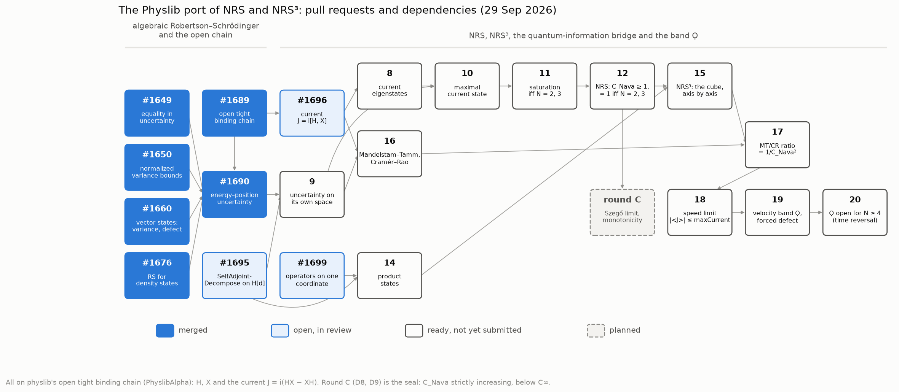
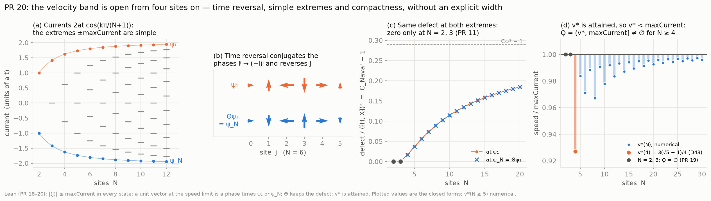

# The Physlib port of RS^N and RS^N³

This repository proves RS^N and RS^N³ over Mathlib. In parallel, the results are being contributed
to [physlib](https://github.com/leanprover-community/physlib) (`PhyslibAlpha`), restated on
physlib's own **open tight binding chain**: Hamiltonian `H` (hopping `t`), position `X`
(spacing `a`) and current `J = i(HX − XH)`, the velocity `d⟨X⟩/dt`. The pair `(T_d, P_d)` of
this repository is that chain with `E0 = 0`, `t = −1/ρ_d`, `a = 2/(d − 1)` and `P_d = X − 1`, so each port states
a result of the corpus in the vocabulary of a mainstream physical model.

Every file is Mathlib, Physlib and PhyslibAlpha only, at most 300 lines, lines of at most 100
characters, no `sorry`, only the standard axioms (`propext`, `Classical.choice`, `Quot.sound`),
and passes the full Physlib CI (build, file imports, `sorry_lint`, `module_doc_lint`, the Physlib
and PhyslibAlpha linters, `forMathlib_lint`, the auxiliary script test and the style linters).
The Physlib files are under Physlib's Apache 2.0 license; this repository stays under the RS^N
Noncommercial License. Status on 12 October 2026: 28 merged, 6 open.

## Pull requests

| PR | File (`PhyslibAlpha/…`; `…/` abbreviates the folder, now `ProbabilisticTheory` for the first four) | Lines | Main results | Corpus | Status |
|---|---|---|---|---|---|
| #1649 | `…/CStarAlgebra/Uncertainty` | +60 | equality in Robertson–Schrödinger iff the Gram defect vanishes | `D1`, `D2` | merged |
| #1650 | `…/CStarAlgebra/Uncertainty` | +20 | normalized variance bounds for algebraic states | `D2` | merged |
| #1660 | `…/HilbertSpace/State/VectorUncertainty` | 69 | variance and Gram defect of vector states | `D21` | merged |
| #1676 | `…/HilbertSpace/State/DensityUncertainty` | 107 | Robertson–Schrödinger for density states | `D2` | merged |
| #1689 | `CondensedMatter/TightBindingChain/OpenBoundary` | 145 | open chain, position, `⟨m|[A, X]|n⟩ = a(n − m)⟨m|A|n⟩` | `D3` | merged |
| #1690 | `…/TightBindingChain/Uncertainty` | 95 | energy–position uncertainty, `⁅H, X⁆` moves one position | `D3`, `D21` | merged |
| #1695 | `QuantumMechanics/HilbertSpaces/FiniteTarget/Operators` | 47 | `SelfAdjointDecompose` on operators of `𝓗[d]` | — | merged |
| #1696 | `…/TightBindingChain/Current` | 112 | current `J`, stationary and localized states carry none | `D38` | merged |
| #1699 | `…/FiniteTarget/Product` | 176 | operators on one coordinate of `𝓗[α × β]` commute across coordinates | `D37` | merged |
| #1708 | `…/TightBindingChain/CurrentEigenstates` | 180 | `J ψ_k = 2at cos(kπ/(N+1)) ψ_k`, `‖ψ_k‖² = (N+1)/2` | `D5`, `D6` | merged |
| #1709 | `…/TightBindingChain/Uncertainty` | 93 (refactor) | the uncertainty relation on the chain's own Hilbert space | — | merged |
| #1716 | `…/TightBindingChain/MaxCurrentState` | 298 | maximal current state; `⟨H⟩ = E0`, `⟨X⟩ = a(N−1)/2`, `⟨⁅H, X⁆⟩ = −at cos(π/(N+1))` | `D5`, `D21` | merged |
| #1718 | `…/TightBindingChain/Saturation` | 216 | Robertson–Schrödinger is an equality iff `N = 2, 3`, strict for `N ≥ 4` | `D23` | merged |
| #1723 | `…/TightBindingChain/ElementalUncertainty` | 144 | `Cov = 0`; `Var H · Var X = (at cos)² + defect`; `CNava ≥ 1`, `= 1` iff `N = 2, 3`; `nava_robertson_schrodinger_elemental_dimensional_uncertainty_inequality` | `D21`, `D22` | merged |
| #1717 | `…/FiniteTarget/ProductState` | 236 | product states: one-coordinate statistics are the factor's | `D37` | merged |
| #1725 | `…/TightBindingChain/Cube` | 265 | the open cube; axes commute; `C_N` per axis; `nava_robertson_schrodinger_cube` | `D37` | merged |
| #1711 | `…/TightBindingChain/MandelstamTamm` | 139 | `|⟨J⟩| ≤ 2 ΔH ΔX` (Mandelstam–Tamm), `⟨J⟩²/Var X ≤ 4 Var H` (Cramér–Rao) | `D41` | merged |
| #1739 | `…/TightBindingChain/MandelstamTammMaxCurrent` | 126 | the ratio is `1/C_N²`, `= 1` iff `N = 2, 3`; per axis of the cube | `D41` | merged |
| #1724 | `…/TightBindingChain/SpeedLimit` | 218 | orthonormal basis of current eigenstates; `⟨J⟩ = 2at cos(π/(N+1))` in the maximal current state; `|⟨J⟩| ≤ 2|at| cos(π/(N+1))` in every state | `D38`, `D40` | merged |
| #1745 | `…/TightBindingChain/VelocityBand` | 172 | minimum-uncertainty vectors are compact; the threshold `v*` is attained; forced defect in `Ϙ` | `D44` | merged |
| #1746 | `…/TightBindingChain/VelocityBandWidth` | 266 | time reversal; `v* < maxCurrent` and `Ϙ ≠ ∅` for `N ≥ 4` | `D44`, `D46` | open |
| #1732 | `…/TightBindingChain/MaxCurrentVariances` | 249 | `Var H = 4t² sin²θ (N−1)/(N+1)`, `Var X = a²(((N+1)²+2)/12 − 1/(2 sin²θ))`, `θ = π/(N+1)`; `C_N²` in closed form (`CNava_sq_eq`) | `D19`, `D20` | merged |
| #1734 | `…/TightBindingChain/LongChainLimit` | 108 | `C_N → √(π²/3 − 2)` along any family of chains with `N → ∞` (`tendsto_CNava`); the limit is `> 1` | `D8` | merged |
| #1735 | `…/TightBindingChain/LongChainMonotonicity` | 297 | `C_N` strictly increasing in `N` from four positions on (`CNava_lt_CNava`); `C_N < √(π²/3 − 2)` | `D9` | merged |
| #1730 | `ProbabilisticTheory/CStarAlgebra/Uncertainty` | +217 | Robertson 1934 for several observables: `Σ + iΩ` is a Gram matrix (`gram_centeredGNSVector`), `\|det Ω\| ≤ det Σ` for every state on a C*-algebra (`robertson_det`) | `D49` | merged |
| #1742 | `…/TightBindingChain/Cube` (E–F) | +319 | the six observables `(H, X)` of the cube: `Ω` block diagonal in every state, `(⟨⁅H,X⁆⟩_x ⟨⁅H,X⁆⟩_y ⟨⁅H,X⁆⟩_z)² ≤ det Σ` (`robertson_det_cube`); at the maximal current state `det Σ = (C_N(x) C_N(y) C_N(z))² \|det Ω\|`, strict from `4 × 4 × 4` (`robertson_det_maxCurrentCubeState_strict`) | `D49b`, `D49c` | merged |
| #1756 | `…/TightBindingChain/VolumetricQuantum` | 228 | RS^N angle `θ_NRS = arccos(1/C_N)`, `= 0` iff `N = 2, 3`, increasing, below `arccos(1/C_N^∞)`; `δ = C_N − 1`; volumetric quantum `δ(Nx)δ(Ny)δ(Nz)`, `= 0` iff an axis has 2 or 3 sites, strictly increasing on each axis | `D37b`, `D37e`, `D39` | merged |
| #1762 | `Relativity/PauliMatrices/Anticommuting` | 145 | at most three anticommuting `2 × 2` involutions; the Pauli matrices attain it | `nrs3-pauli-dirac` (1925) | merged |
| #1768 | `Relativity/Fermions/Dirac/MinimalDimension` | 171 | a Clifford family has even size, no `2 × 2` one exists, the minimum is four, attained by Physlib's `gamma` | `nrs3-pauli-dirac` (1928) | merged |
| #1752 | `…/CStarAlgebra/UncertaintyCone`, `…/TightBindingChain/UncertaintyCone` | 209 + 139 | `det A = v₀² − \|v⃗\|²`; Robertson–Schrödinger is the future cone, null iff saturated; `⟪v, v⟫ₘ = defect` (`minkowski_gramVector`); the three axes of the cube are timelike from `4 × 4 × 4` (`minkowski_axisVector_cube_pos`) | `nrs3-uncertainty-cone` | open |
| #1761 | `QuantumMechanics/Blackbody/RayleighJeans` | 210 | quantized and classical oscillators as canonical ensembles; Planck's `spectralRadiance` lies strictly below Rayleigh–Jeans | `nrs3-poincare` (1911) | open |
| #1773 | `…/TightBindingChain/VelocityBand`, `…/FiniteTarget/ProductState` | +272 | on the open cube, every normalized state whose speed along an axis lies in that axis's band has a strictly positive defect along that axis (every state, not only products) | `D49t` | open |
| #1774 | `…/CStarAlgebra/Uncertainty`, `…/State/VectorUncertainty` | +248 | equality case of Robertson 1934: `\|det Ω\| = det Σ` forces at least `n/2` independent linear relations among the fluctuations (`card_le_two_mul_finrank_ker_gram_fluctuation`) | `D49` | open |
| #1775 | `…/TightBindingChain/Current` | +244 | `J` is a multiple of the hopping (`current_eq_hopping`); `[J, X]` (`current_comp_position_sub`) and `[H, J]` (`openHamiltonian_comp_current_sub`) | `D38` | open |

## Ready on the fork, not yet pull requests

Each branch below is on [naype888-cloud/physlib](https://github.com/naype888-cloud/physlib),
rebased on Physlib master, and passes the full Physlib CI. They go up as pull requests a few at a
time, as the open ones are merged. Comments are welcome on the Zulip channel
**#quantum information**.

| Branch | File | Lines | Main results | Corpus | Depends on |
|---|---|---|---|---|---|
| [`blackbody-quantum-necessity`](https://github.com/naype888-cloud/physlib/tree/feat-physlibalpha-blackbody-quantum-necessity) | `QuantumMechanics/Blackbody/QuantumNecessity` | 270 | Poincaré 1912: Planck's mean energy at every temperature forces the density of states to be `c · ∑ₙ δ_{nε}` | `nrs3-poincare` (1912) | #1761 |
| [`tight-binding-cut-bonds`](https://github.com/naype888-cloud/physlib/tree/feat-physlibalpha-tight-binding-cut-bonds) | `…/TightBindingChain/CutBonds` | 112 | the `(c + 1)(N − 1 − c) − 1` bonds of range at least two across a cut | `D16g` | master |
| [`cosmology-de-sitter-horizon-entropy`](https://github.com/naype888-cloud/physlib/tree/feat-cosmology-de-sitter-horizon-entropy) | `Physlib/Cosmology/FLRW/DeSitterHorizon` | 160 | `r = c/\|H\|`, `S = 3π/(ℓ²Λ)`, `Λ = 3π/(ℓ²S)` solves both Friedmann equations | `nrs3-de-sitter` | master |
| [`cosmology-varying-vacuum`](https://github.com/naype888-cloud/physlib/tree/feat-cosmology-varying-vacuum) | `Physlib/Cosmology/FLRW/VaryingVacuum` | 176 | energy balance `∂ₜρ + 3H(ρ + p/c²) = −∂ₜρ_Λ` for a time-dependent `Λ`, from the Friedmann equations | `nrs3-de-sitter` | master |
| [`horizon-count`](https://github.com/naype888-cloud/physlib/tree/feat-physlibalpha-horizon-count) | `…/TightBindingChain/HorizonCount` | 193 | **`Λ = 3π/(ℓ² log W)`** from `W = Mᵏ` states on the bonds across a cut; both Friedmann equations; `Λ > 0`, decreasing, `→ 0`; `3π/(ℓ² M log 2) ≤ Λ` on distinct bonds | `nrs3-de-sitter` | cut bonds, de Sitter |
| [`loop-quantum-gravity`](https://github.com/naype888-cloud/physlib/tree/feat-physlibalpha-loop-quantum-gravity) | `QuantumGravity/LoopQuantumGravity/AreaSpectrum`, `…/TightBindingChain/LinkPuncture` | 170 + 102 | LQG area spectrum and its lowest quantum; puncture entropy `∝` area; Bekenstein–Hawking iff `γ = log 2/(π√3)`; a bond across the cut is a puncture; at that `γ`, `Λ = 12π/A` with `A` the area of `k` lowest quanta | `nrs3-rovelli-lqg` | horizon count |
| [`cut-cycles-curvature`](https://github.com/naype888-cloud/physlib/tree/feat-physlibalpha-cut-cycles-curvature) | `…/TightBindingChain/CutCycles`, `…/TightBindingChain/EntropyCurvature` | 226 + 102 | the chain is a tree; each bond across the cut closes one independent cycle; the entropy counts graphs; with the Gauss–Bonnet curvature of `Σ_g` (a definition: Mathlib has no Gauss–Bonnet), `S = (log M/2π)(4π − ∫K dA)` | `D16e`–`D16h`, `nrs3-defect-curvature` | horizon count |
| [`cosmological-constant-chain`](https://github.com/naype888-cloud/physlib/tree/feat-physlibalpha-cosmological-constant-chain) | `…/TightBindingChain/CosmologicalConstantChain` | 108 | the chain in one theorem: on four sites, with `2g` quanta on the first cut, `Λ = 3π/(ℓ² log W) = 3π/(ℓ² 2g log 2) = 12π/A = 6π²/(ℓ² log 2 (4π − ∫K dA))`; horizon entropy `log W`, `Λ > 0`, both Friedmann equations | `nrs3-de-sitter`, `nrs3-rovelli-lqg`, `nrs3-defect-curvature` | loop quantum gravity, curvature |
| [`nrs3-cosmological-constant`](https://github.com/naype888-cloud/physlib/tree/feat-physlibalpha-nrs3-cosmological-constant) | `…/TightBindingChain/DefectCosmologicalConstant` | 152 | the bridge RS^N³ → `Λ`: each quantum carries `δ = C_N − 1`, `Ω = k δ`; `Ω = 0` at `2`, `3` sites, `0 < Ω < k(√(π²/3 − 2) − 1)` from `4`; `S = (log M/δ) Ω`; `Λ = 3π δ/(ℓ² log M Ω)`; on the cube `Ω_x = 0` iff the relation of the `x` axis is an equality; from `4 × 4 × 4` strict on the three axes and `Ω_x > 0` | `nrs3-de-sitter` (section B), #1725 | the chain in one theorem, volumetric quantum |
| [`landauer`](https://github.com/naype888-cloud/physlib/tree/feat-physlibalpha-landauer) | `StatisticalMechanics/Landauer`, `…/Carnot` | 224 + 144 | Landauer for a unitary on `ρ ⊗ γ`; Kelvin–Planck; Carnot `W ≤ (1 − T_c/T_h) Q_h` | `nrs3-landauer-carnot` | QuantumInfo |

Next submissions, in order: Poincaré 1912 (after #1761); then the chain cut bonds → horizon count → loop
quantum gravity and curvature, with the cosmology files, then the chain in one theorem, and last the bridge RS^N³ → `Λ`.

## Order of submission (first series, done)

At most three pull requests are open at a time; each wave goes up when the previous one is
merged. The dependencies are those of the `import` lines.

| Wave | Pull requests | Depends on |
|---|---|---|
| 0 | #1695, #1696, #1699 | merged work |
| 1 | 8, 9, 14 | #1696; #1695; #1699 |
| 2 | 10, 16 | 8, 9; #1696, 9 |
| 3 | 11, 18 | 10; 10, 16 |
| 4 | 12 (RS^N), 19 | 11; 11, 18 |
| 5 | 15 (RS^N³), 20, 21 | 12, 14; 19, #1699; 12 |
| 6 | 17 (Mandelstam–Tamm, Cramér–Rao), 22 | 15, 16, 18; 21 |
| 7 | 23 (monotonicity) | 22 |
| any | 24 (Robertson 1934) | master |
| after 15 | 25 (det\|RS^N³ on the cube) | 15, 24 |

## det|RS^N³ (PR 24 and after)

PR 24 brings Robertson's 1934 relation for several observables to the algebraic states of
`PhyslibAlpha`, in the file of Robertson–Schrödinger. In this repository the same bound is
`D49`, and its instances on the cube are `D49b`–`D49d`: the three conjugate pairs give
`det Σ ≥ (t_x t_y t_z / 8)²` for every state, the ratio is `C_N(dx)² C_N(dy)² C_N(dz)²` at
the maximal current state of the cube, and the bound is strict for product states in the band `Ϙ`. PR 25 ports `D49b` and the
the maximal current state of the cube part of `D49c` to the open cube (branch `feat-physlibalpha-tight-binding-cube-determinant`,
two commits of 138 and 181 lines on #1725 and PR 24). The band part (`D49d`) waits for PRs 19
and 20.

## Round C: shorter than the corpus (PRs 21–23)

The corpus reaches `C_N < C_N^∞` through `D19` and `D20` (the closed form, 1142 lines) and `D8`,
`D9` (limit and monotonicity, 1248 lines). The port needs 654 lines in three files, for two
reasons.

* **One sum at a root of unity.** The position variance of the maximal current state rests on
  `∑ j < n, (j − n/2)² cos(2jθ) = n/(2 sin²θ)` with `n = N + 1`, `θ = π/n`. Summation by parts
  against the powers of `z = e^{2iθ}`, a root of unity of order `n`, gives
  `∑ j < n, (j − n/2)² zʲ = −2nz/(z − 1)²`, which is real and equal to `n/(2 sin²θ)`. The
  weighted root, period and angle sums of the earlier series are not needed.
* **A certificate in one variable.** `D9` bounds the remainder of the derivative of `C_N²` by a
  Bernstein certificate in two variables `(x/π, π)` of degree `(12, 12)`: 169 terms and
  `maxHeartbeats 4000000`. Written in `x = π/(N + 1)` the remainder has degree three in `π`;
  with `3.141592 < π < 3.141593` each power of `π` is bounded by the sign of its coefficient, and
  what is left is one polynomial of degree twelve in `x ∈ [0, 1571/2500]` whose thirteen
  Bernstein coefficients are negative (the largest is `≈ −1169`). The file builds with the
  default heartbeats. The positivity `C_N > 1` for `N ≥ 4` (the Taylor half of `D8`) is not
  ported: it is the Gram defect of PRs 11 and 12.

## A new proof that the band is open (PR 20)

`D44` shows `ϙ(d) > 0` for `d ≥ 4` through the explicit width of `D23b`–`D23d`. PR 20 proves
`Ϙ ≠ ∅` without it: time reversal `Θ` (complex conjugation) commutes with `H` and `X`, reverses
`J` and keeps the defect; the extremes `±maxCurrent` of the current are simple, with eigenvectors
the maximal current state `ψ₁` and `ψ_N = Θψ₁`; a unit vector at the speed limit is a phase times
one of them, so it carries the defect of `ψ₁`, positive from four positions on; the threshold `v*` is
attained (compactness), hence `v* < maxCurrent`. The explicit width stays in `D23d`.

Script for both figures: `docs/simulation/figures_physlib_port.py`.
